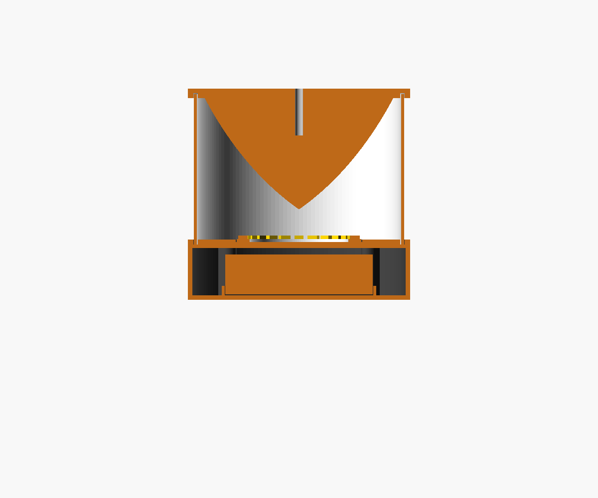
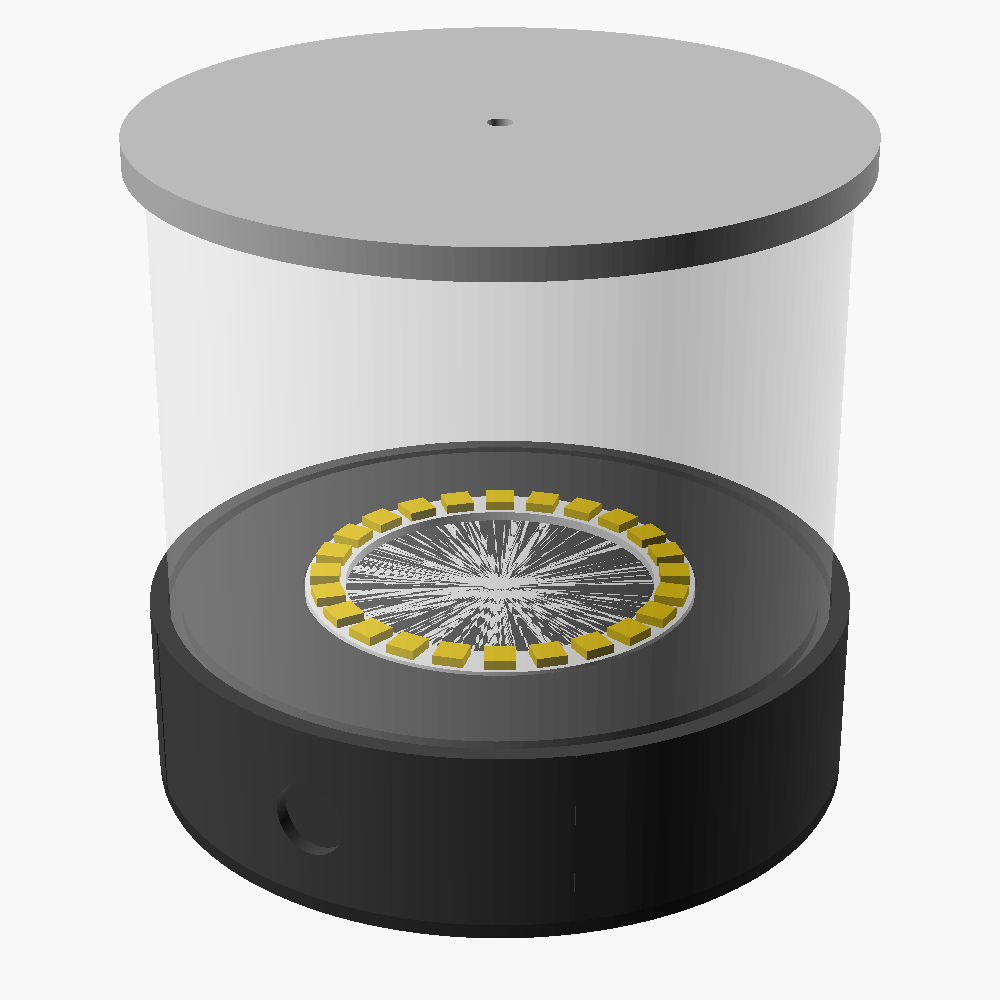

# Reflector Lantern

About 118 mm wide × 112 mm tall. A 24-LED RGBW ring points up into a curved mirror that throws light out 360°, spread from about 30° below to about 50° above the horizon.

 

## Files
- `lantern.scad`: the parametric model. Set `part` to export a part, or open it in OpenSCAD and use the Customizer.
- `stl/`: the exported parts, already oriented for printing.
- `raysim.py`: a 2D ray trace of the mirror. Run it again whenever you change `z_tip`, `th_in`, `th_out` or `R_ref` (for example `python raysim.py th_out=65`).

## Parts and printing
| Part | Material | Notes |
|---|---|---|
| base | PLA or PETG, black or white | Prints top face down, with no supports. A white top plate bounces stray light back up. |
| lid | any | Has a fence that locates the battery holders. Stick the holders down with double-sided tape. |
| reflector | PLA | Prints flange down, with no supports. Use 10–15% infill. Sand the curved surface (240 → 800 grit), then make it a mirror (see below). |
| tube or tube_vase | clear or natural PETG | `tube` has a 1.6 mm wall. For `tube_vase`, slice in spiral/vase mode with about a 0.8 mm line width. Natural PETG diffuses the light nicely. |

**Making the mirror (best first):**
1. Molotow Liquid Chrome over a glossy black primer.
2. Aluminized mylar or chrome vinyl cut into gores.
3. Silver spray paint (dull but even).

**Before you print:** measure your DFRobot holders and set `holder_l`, `holder_w` and `holder_h`. The defaults are typical 18650 holder sizes.

## Electronics (BOM)
- Adafruit NeoPixel Ring 24× RGBW (#2862), or any 66 mm SK6812/WS2812 ring
- ESP32-C3 SuperMini, running WLED
- 2× 18650 cells in the DFRobot holders, **wired in parallel (1S2P)**
- A USB-C charger with 5 V boost that handles 2 A or more (e.g. an IP5306-based board). It sits on the lid with its port in the bottom notch.
- 12 mm latching push button, mounted in the side hole
- 300–470 Ω resistor in the data line, and a 470–1000 µF capacitor across the LED 5 V/GND

```
18650 ||  →  charger/boost (USB-C)  →  button  →  5V ─┬─ LED ring 5V
                                                      └─ ESP32-C3 5V
GND common ·  ESP32 GPIO → 330Ω → ring DIN
```

- **Power:** at full white the ring draws up to about 1.4 A. Set WLED's current limit to 1200 mA.
- **Runtime:** two ~3000 mAh cells give roughly 6–10 h at a cozy brightness.
- **First flash:** flash WLED over USB before you assemble anything. After that, update over the air.

## Assembly
1. Fit the ring in its pocket, feed its wires through the slot, and hot-glue it in place.
2. Fit the button, then wire the charger, ESP32 and holders.
3. Screw the lid on with 4× M3×10 self-tapping screws.
4. Press the tube into the base groove, then press the reflector onto the top of the tube. A dab of glue keeps it from coming apart.
5. Optional: fit an M4 eye bolt in the top hole so you can hang the lantern.
